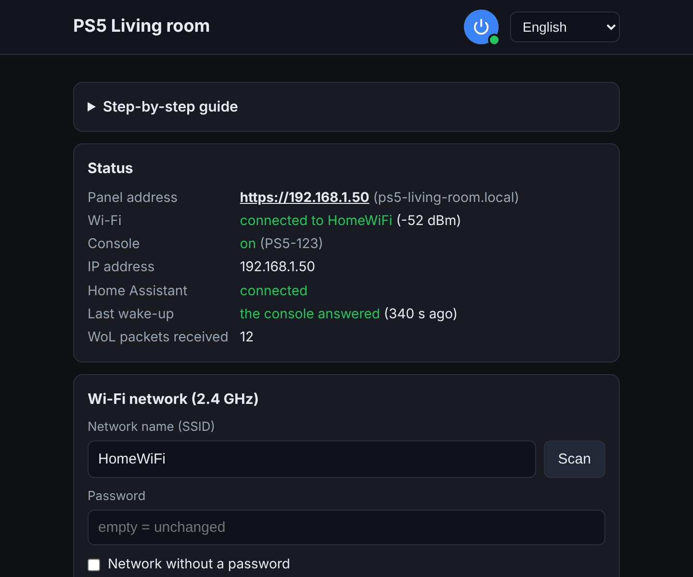
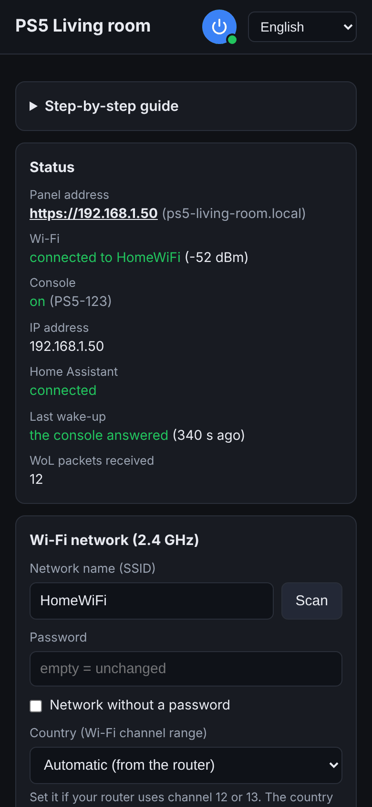
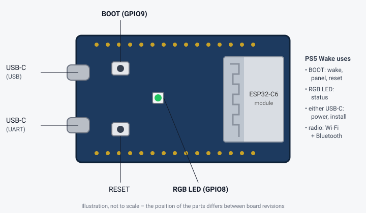

# PS5 Wake for ESP32-C6

[](https://github.com/AdikX83/ps5-wake-esp32/actions/workflows/ci.yml)
[](LICENSE)

**Turn your PlayStation 5 on from anywhere on your network with Wake-on-LAN – using an inexpensive ESP32-C6 board.**

The PS5 does not support Wake-on-LAN. It does wake up when its paired DualSense controller connects over
Bluetooth. PS5 Wake is firmware for an ESP32-C6 that listens for Wake-on-LAN packets on your Wi-Fi and then
connects to the console over Bluetooth **as your paired controller** – so the PS5 turns on, from rest mode or
when fully switched off.

> **Language / Język / Sprache / Langue / Idioma / 言語 / 语言** – the user guide is available in 30 languages:
> [see the list below](#user-guide-in-your-language). The setup panel on the device is translated too.

## Features

- Wakes the PS5 from **rest mode** and from **fully off** (tested).
- Triggered by **Wake-on-LAN** – UDP (ports 9 and 7) and raw Ethernet frames sent by routers (e.g. ASUS /
  Asuswrt-Merlin) – or by a **short press of the BOOT button** on the board.
- **Setup panel** in the browser over HTTPS, in **30 languages** – in your home network, or through the board's own
  Wi-Fi network (`https://192.168.4.1`): Wi-Fi, controller and console addresses, Wake-on-LAN options, wake button,
  status.
- **Console state** (on / rest mode / off) shown next to the wake button and sent to Home Assistant.
- **Address reader** for Windows (no installation), macOS and Linux – downloadable from the panel.
- **Home Assistant** integration over MQTT discovery (wake button, result of the last attempt) and a
  [REST API](docs/technical/api.md) – see [Home Assistant](docs/integrations/home-assistant.md).
- **RGB status LED** (ready, connecting, no Wi-Fi, wake in progress, success / failure…).
- Self-healing Wi-Fi, factory reset (hold BOOT 20 s), no cloud, no account, nothing leaves your network.

## Setup panel

<p align="center">
  
  &nbsp;
  
</p>

The power button in the header wakes the console; the dot on it shows the console state (green on, orange rest
mode, red off). Example data. [Whole page](docs/images/panel-full.png) – Wi-Fi, Bluetooth addresses,
Wake-on-LAN, LED, panel access, HTTPS and Home Assistant settings.

## How it works (short)

The ESP32-C6 officially supports only Bluetooth LE, but waking a PS5 needs **Bluetooth Classic**. PS5 Wake uses
[Soft-BR](https://github.com/ernimen7/esp32-p4-c6-le-audio), an experimental software Bluetooth Classic engine for
the ESP32-C6 radio, plus a small radio fix and the standard LMP connection setup. On a Wake-on-LAN packet the
ESP32 takes the Bluetooth address of your paired DualSense and pages the console – exactly what the controller
does when you press its PS button. Details: [docs/technical/how-it-works.md](docs/technical/how-it-works.md).

## What you need

| Item | Notes |
|---|---|
| **ESP32-C6 board** | Tested: **ESP32-C6-DevKitM-1**. Other ESP32-C6 boards: see [Supported boards](#supported-boards). **Other ESP32 chips (ESP32, S3, C3, C5, H2…) are not supported.** |
| **PS5 + DualSense** | The DualSense (or DualSense Edge) must already be paired with the console. |
| **A computer** | Once, to install the firmware from the browser (Chrome/Edge) and to read the controller addresses over USB. |
| **2.4 GHz Wi-Fi** | WPA2/WPA3. |
| **A Wake-on-LAN sender** | Any WoL app, your router's WoL page, a script, Home Assistant… |

## Supported boards



The firmware needs an **ESP32-C6** with **at least 4 MB flash** and a **BOOT button on GPIO9** (standard on ESP32-C6
boards – GPIO9 is the chip's boot strapping pin). The status LED works only with an **addressable RGB LED (WS2812)
on GPIO8**; on other boards everything else works, just without LED messages. Either USB-C port can be used.

| Board | Flash | Status LED | State |
|---|---|---|---|
| Espressif **ESP32-C6-DevKitM-1** | 4 MB | ✅ RGB on GPIO8 | **tested** |
| Espressif ESP32-C6-DevKitC-1 | 8 MB | ✅ RGB on GPIO8 | expected to work |
| Waveshare ESP32-C6-LCD-1.47 | 4 MB | ✅ RGB on GPIO8 | expected to work (display unused) |
| Waveshare ESP32-C6-Zero | 4 MB (8 MB in some versions) | WS2812 – check the pin in the vendor's pinout | expected to work |
| Seeed Studio XIAO ESP32C6 | 4 MB | ❌ (single LED on GPIO15) | expected to work |
| M5Stack NanoC6 | 4 MB | ❌ (RGB on GPIO20) | expected to work |
| DFRobot FireBeetle 2 ESP32-C6 | 4 MB | ❌ (single LED on GPIO15) | expected to work |
| DFRobot Beetle ESP32-C6 | 4 MB | ❌ (single LED on GPIO15) | expected to work |

"Expected to work" means the board meets the requirements but has not been tested with a PS5 yet – reports are
welcome (open an issue with the board name and whether waking works). The Bluetooth part is a software
implementation; range depends on the board's antenna, so keep the board within a few metres of the console.

## Quick start

1. **Install the firmware**: open the **[web installer](https://adikx83.github.io/ps5-wake-esp32/)** in Chrome or
   Edge, connect the board with a USB cable and click *Install*. (Or flash a release manually, see
   [building.md](docs/technical/building.md).)
2. **Open the setup panel**: a new device starts the panel network by itself (purple LED); later, hold **BOOT** for
   5–20 s and release it (the LED turns red). Connect to the Wi-Fi network **`PS5-WAKE-xxxx`** (password
   `ps5wol-setup`) and open **`https://192.168.4.1`** (or `https://ps5-wake-xxxx.local`). Accept the browser's certificate
   warning – the ESP32 uses its own certificate.
3. **Read the controller addresses**: plug the DualSense into your computer with a USB cable, download the address
   reader from the panel and run it. Paste the setup code it copies into the panel.
4. **Fill in your Wi-Fi**, choose a **new panel password** (required – the default one is public) and click
   **Save and restart**. The LED turns green when ready.
5. **Send Wake-on-LAN** to the ESP32's MAC address shown in the panel (UDP port 9, broadcast address).

Full step-by-step guide with the button and LED tables and troubleshooting: [user guide](#user-guide-in-your-language).

## User guide in your language

| | | | |
|---|---|---|---|
| [English](docs/en/user-guide.md) | [Български](docs/bg/user-guide.md) | [Čeština](docs/cs/user-guide.md) | [Dansk](docs/da/user-guide.md) |
| [Deutsch](docs/de/user-guide.md) | [Eesti](docs/et/user-guide.md) | [Ελληνικά](docs/el/user-guide.md) | [Español](docs/es/user-guide.md) |
| [Français](docs/fr/user-guide.md) | [Gaeilge](docs/ga/user-guide.md) | [Hrvatski](docs/hr/user-guide.md) | [Italiano](docs/it/user-guide.md) |
| [Latviešu](docs/lv/user-guide.md) | [Lietuvių](docs/lt/user-guide.md) | [Magyar](docs/hu/user-guide.md) | [Malti](docs/mt/user-guide.md) |
| [Nederlands](docs/nl/user-guide.md) | [Norsk](docs/no/user-guide.md) | [Polski](docs/pl/user-guide.md) | [Português](docs/pt/user-guide.md) |
| [Română](docs/ro/user-guide.md) | [Slovenčina](docs/sk/user-guide.md) | [Slovenščina](docs/sl/user-guide.md) | [Suomi](docs/fi/user-guide.md) |
| [Svenska](docs/sv/user-guide.md) | [Türkçe](docs/tr/user-guide.md) | [Українська](docs/uk/user-guide.md) | [简体中文](docs/zh/user-guide.md) |
| [日本語](docs/ja/user-guide.md) | [한국어](docs/ko/user-guide.md) | | |

Translations other than English were prepared with the help of AI – corrections from native speakers are very
welcome, see [CONTRIBUTING.md](CONTRIBUTING.md).

## Wake-on-LAN senders and routers

- Send the packet to the **ESP32's MAC** (shown in the panel) on UDP port **9** (or 7), to the **broadcast
  address** of your network (e.g. `192.168.1.255`). Reserve a fixed IP address for the ESP32 in your router.
- If your app or router already uses the **PS5's own network MAC**, enter it in the panel – the ESP32 then reacts
  to it too. **In mesh networks (e.g. ASUS AiMesh) such packets may not reach the ESP32** – use the ESP32's MAC.
- Router WoL pages that send raw Ethernet frames (Asuswrt / Asuswrt-Merlin `ether-wake`) are supported.

## Home Assistant and API

- [Home Assistant](docs/integrations/home-assistant.md): MQTT (recommended), the Wake on LAN integration, or REST.
- [REST API](docs/technical/api.md): endpoints of the panel for scripts and automations.

## Status and limitations

- **Experimental.** Bluetooth Classic on the ESP32-C6 is a software implementation outside Espressif's official
  SDK. It works reliably in our tests, but has been tested on few setups so far.
- Tested with: ESP32-C6-DevKitM-1, PS5 (rest mode and fully off), DualSense, Asuswrt-Merlin router with AiMesh.
  Please report your results (working or not) in an [issue](../../issues) – it helps others.
- The console must have been woken by the controller before (normal pairing). The ESP32 does not pair with the
  console and does not know the controller's link key; it only wakes the console.
- Wake-on-LAN works inside your local network. Waking from the internet requires your own VPN or router setup.

## Building from source

ESP-IDF **5.5.5** (exactly), then:

```sh
git clone --recursive https://github.com/AdikX83/ps5-wake-esp32.git
cd ps5-wake-esp32/firmware
idf.py set-target esp32c6 build flash monitor
python ../tools/verify_build.py
```

Details, CI and release process: [docs/technical/building.md](docs/technical/building.md).

## Contributing

Bug reports, test results with other boards/consoles/routers, fixes and translation improvements are welcome –
see [CONTRIBUTING.md](CONTRIBUTING.md). Security issues: [SECURITY.md](SECURITY.md).

## License and credits

MIT – see [LICENSE](LICENSE) and [NOTICE.md](NOTICE.md). Built on
[Soft-BR / esp32-p4-c6-le-audio](https://github.com/ernimen7/esp32-p4-c6-le-audio) by Ernest Domaradzki (MIT).
Wake method studied in [bizkut/ps5-esp32-wakeup](https://github.com/bizkut/ps5-esp32-wakeup) and
[FreeTHX/pywakepsXonbt](https://github.com/FreeTHX/pywakepsXonbt).

*PlayStation, PS5 and DualSense are trademarks of Sony Interactive Entertainment Inc. This project is unofficial
and not affiliated with or endorsed by Sony Interactive Entertainment or Espressif Systems.*
